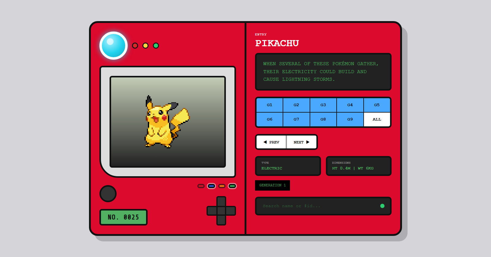

# Pokédex

Pokédex online feita com Vue 3 e TypeScript, que consome a [PokéAPI](https://pokeapi.co/). O layout imita um aparelho e mostra um Pokémon por vez, de todas as 9 gerações (1025 Pokémon).

**Acesse:** https://raphaelwilker.github.io/pokedex/



## Funcionalidades

- Navegação pelos Pokémon, filtrada por geração (G1–G9 ou ALL)
- Busca por nome ou número (`pikachu`, `#25`)
- Nome, número, texto da entrada, tipos, altura e peso
- Geração e região de origem (Kanto, Johto, Hoenn, Sinnoh, Unova, Kalos, Alola, Galar e Paldea)
- Sprites animadas (GIFs da geração V ou do Pokémon Showdown), com sprite estática quando não há animação
- Formas macho e fêmea (quando a espécie tem sprite diferente), shiny e vista de costas
- Cry (som) de cada Pokémon
- O Pokémon atual fica na URL (`/#/pokemon/25`), então dá para compartilhar o link

## Controles do aparelho

| Controle | O que faz |
|---|---|
| Botão redondo | Toca o cry do Pokémon |
| Cruz, direita / esquerda | Próximo / anterior |
| Cruz, cima / baixo | Alterna entre frente e costas |
| Botão vermelho (**Female ♀**) | Mostra a fêmea |
| Botão azul (**Male ♂**) | Mostra o macho |
| Botão amarelo (**Shiny**) | Mostra a versão shiny |
| Botão verde (**Comum**) | Mostra a versão normal |

Os botões vermelho e azul só ficam habilitados quando o Pokémon tem aquele sexo (por exemplo, o Nidoran-F é só fêmea e Pokémon sem sexo, como o Magnemite, desabilitam os dois). Isso vem do campo `gender_rate` da espécie na PokéAPI.

## Tecnologias

- [Vue 3](https://vuejs.org/) (`<script setup>`), [Pinia](https://pinia.vuejs.org/) e [Vue Router](https://router.vuejs.org/) (hash history)
- [TypeScript](https://www.typescriptlang.org/) em modo estrito, verificado com `vue-tsc`
- [Vite](https://vite.dev/) para desenvolvimento e build
- [Vitest](https://vitest.dev/) e Vue Test Utils para os testes
- GitHub Actions e GitHub Pages para o deploy

## Como rodar

Requer [Node.js](https://nodejs.org/) 20 ou mais recente.

```bash
npm install
npm run dev
```

O servidor sobe na porta 3000. Se ela estiver ocupada, usa a 3001, depois a 3002, e assim por diante.

### Scripts

| Comando | Descrição |
|---|---|
| `npm run dev` | Servidor de desenvolvimento |
| `npm test` | Testes (Vitest) |
| `npm run typecheck` | Verificação de tipos (código e testes) |
| `npm run build` | Verifica os tipos e gera a build de produção em `dist/` |
| `npm run preview` | Serve a build localmente |
| `npm run cap:sync` | Gera a build e copia para os apps (`android/` e `ios/`) |
| `npm run android:apk` | Gera o APK de debug do Android (precisa de JDK 21 e Android Studio) |
| `npm run icons` | Gera ícones e splash dos apps a partir de `resources/` |

## Estrutura

```
src/
├── api/          # cliente da PokéAPI (pokeapi.ts)
├── cache/        # cache permanente (IndexedDB): dados e mídia já vistos
├── components/   # componentes Vue (tela, cruz, botões, painéis)
├── data/         # gerações e regiões
├── native/       # o que só existe no app (vibração, barra de status, splash)
├── router/       # rotas e sincronização com a store
├── stores/       # store Pinia (estado e lógica da Pokédex)
├── styles/       # CSS do aparelho
├── types.ts      # tipos compartilhados
└── main.ts
android/          # projeto Android (Capacitor)
ios/              # projeto iOS (Capacitor)
resources/        # imagens de origem do ícone e da splash
public/           # favicon, imagem de pré-visualização, robots.txt, sitemap.xml e llms.txt
```

Os testes ficam ao lado do código, em arquivos `*.test.ts`.

## Publicação (GitHub Pages)

O deploy é automático: a cada push na `main`, o workflow [`.github/workflows/deploy.yml`](.github/workflows/deploy.yml) roda a verificação de tipos e os testes, gera a build e publica. Se algum passo falhar, o site não é atualizado.

Em *Settings → Pages*, a origem (**Source**) deve ser **GitHub Actions**.

As rotas usam `#` (hash) e os caminhos da build são relativos, para funcionar no GitHub Pages sem configuração de servidor.

## App para celular (Android e iOS)

O mesmo código vira app com o [Capacitor](https://capacitorjs.com/) (sucessor do Cordova/PhoneGap): o `dist/` é copiado para dentro dos projetos `android/` e `ios/`. O app abre sem internet, e os Pokémon, sprites e cries que você já viu ficam guardados no aparelho (até ~50 MB de mídia) e continuam disponíveis offline. Isso vale também para o site.

**Android**
- Sem instalar nada: na aba **Actions** do GitHub, abra a execução mais recente do workflow *Mobile builds* e baixe o arquivo `pokedex-debug-apk`.
- No seu computador: instale o JDK 21 e o Android Studio e rode `npm run android:apk`. O arquivo fica em `android/app/build/outputs/apk/debug/app-debug.apk`.
- Para instalar, copie o APK para o celular e permita instalar de "fontes desconhecidas".

**iOS**
- O projeto compila no GitHub Actions (Mac virtual), **sem assinatura**, para o simulador. Isso confirma que o projeto está saudável, mas não instala em iPhone real nem vai para a App Store: isso exige uma conta Apple Developer.

**Não incluído ainda:** assinatura e publicação na Play Store e na App Store.

## SEO

O `index.html` traz título, descrição, URL canônica, Open Graph, Twitter Card e dados estruturados (JSON-LD). A pasta `public/` tem `robots.txt`, `sitemap.xml` e `llms.txt` (resumo do projeto para assistentes de IA).

## Créditos

- Dados e sprites: [PokéAPI](https://pokeapi.co/)
- Inspiração do layout: https://poke-love-dex.lovable.app/
- Projeto de fã, sem fins comerciais. Pokémon e seus personagens são marcas da Nintendo, Game Freak e The Pokémon Company.

## Licença

ISC
